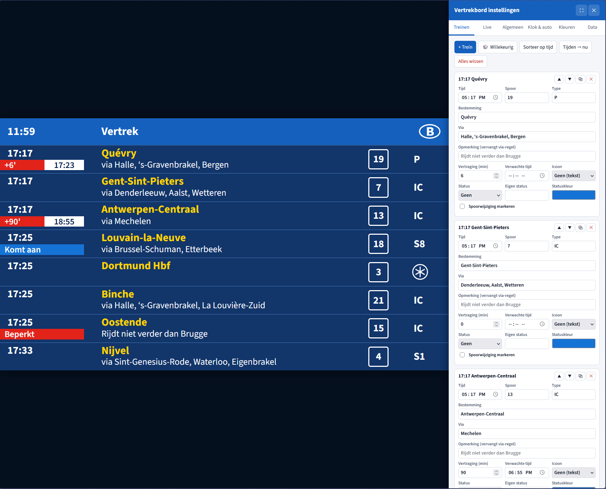

# NMBS Vertrekbord Simulator

Een volledig instelbare simulatie van het vertrekbord van de NMBS/SNCB in Belgische stations.

Er zijn twee versies:

- **Webversie**: open `index.html` in een browser; er is geen build of server nodig.
- **Desktop-app in Rust** voor Windows, macOS en Linux: zie [`desktop/README.md`](desktop/README.md).
  Kant-en-klare downloads worden automatisch gebouwd door GitHub Actions.

Voor de live gegevens is een internetverbinding nodig (tab **Live** → *Gegevensbron: Live NMBS-gegevens*).

## Functies

- **Live klok** linksboven in Belgische tijd (live, met verschuiving, of een eigen simulatietijd met instelbare snelheid).
- **Live NMBS-gegevens** via de open [iRail API](https://docs.irail.be): kies een willekeurig station,
  vertrek- of aankomstbord, en filter eventueel op één of meer sporen (perronscherm). Toont echte tijden,
  vertragingen, sporen, spoorwijzigingen, afgeschafte treinen en via-stations, en ververst automatisch.
- **Treinen bewerken**: tijd, bestemming, via, opmerking, spoor, type (IC, S1, P, …), internationaal icoon,
  vertraging met nieuwe verwachte tijd, status (*Komt aan*, *Beperkt*, *Afgeschaft* of eigen tekst) en spoorwijziging.
- **Automatische simulatie**: treinen verdwijnen na vertrek, het bord vult zich aan met willekeurige treinen,
  automatisch sorteren en automatisch *Komt aan* tonen.
- **Weergave**: titel, taal (NL/FR/DE/EN of wisselend), aantal rijen, logo, seconden, knipperende klok,
  scrollende lange teksten en alle kleuren.
- Instellingen worden in de browser bewaard; exporteren/importeren als JSON.

## Sneltoetsen

| Toets | Actie |
| --- | --- |
| `P` | Instellingenpaneel tonen/verbergen |
| `F` | Volledig scherm |
| `R` | Willekeurige trein toevoegen |

Voeg `#display` toe aan de URL om het bord te openen zonder instellingenpaneel.
